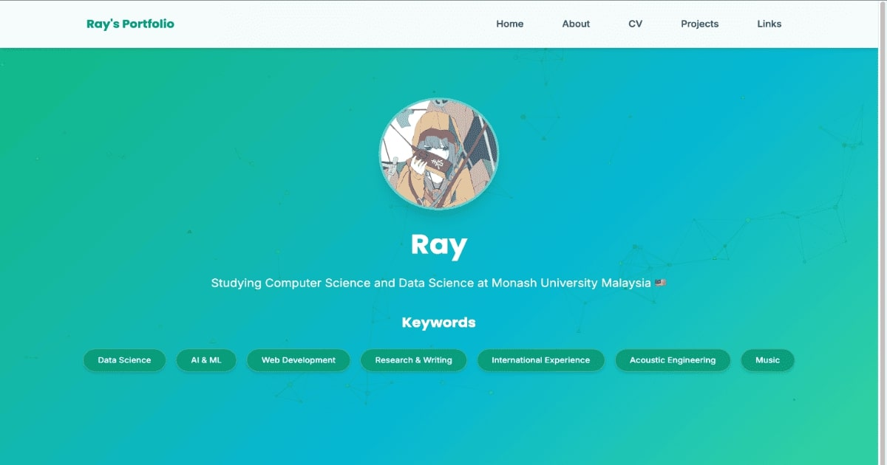

# ポートフォリオウェブサイト テンプレート

[](https://opensource.org/licenses/MIT)
[](https://nodejs.org/)

**[🇬🇧 English Version](README.md)**

---

バニラHTML、CSS、JavaScriptで構築された、シンプルでレスポンシブな**日英バイリンガル対応**のポートフォリオテンプレートです。自由にフォーク、カスタマイズ、デプロイできます。

**[🌟 デモサイト](https://rayramy04.github.io/portfolio/)**



## 主な機能

- **バイリンガル** - 日本語/英語の完全対応、ナビの切替ボタンと `?lang=` URLパラメータに対応
- **データ駆動** - JSON形式のJavaScriptファイルでコンテンツを管理
- **レスポンシブ** - モバイルファーストデザイン、全デバイス対応
- **依存関係ゼロ** - ピュアHTML/CSS/JS、ビルド不要
- **SEO最適化** - メタタグ、サイトマップ、構造化データ対応
- **カスタマイズ可能** - 簡単な色テーマとコンテンツ更新
- **フォークフレンドリー** - マージ戦略でカスタマイズを保護

## クイックスタート

```bash
# 1. GitHubでこのリポジトリをフォーク

# 2. フォークをクローン
git clone https://github.com/あなたのユーザー名/portfolio.git
cd portfolio

# 3. コンテンツを編集
vim data/seo-config.js    # 名前、URL、メタタグ
vim data/common.js        # SNSリンク、ナビゲーション
vim data/home.js          # トップページ（見出し・ボタン）
vim data/links.js         # リンク集ページ
vim data/about.js         # 自己紹介と価値観
vim data/summary.js       # 簡易サマリー
vim data/cv.js            # 経歴とスキル
vim data/projects.js      # プロジェクト

# 4. HTMLページを再生成
node generate-pages.js

# 5. ローカルでテスト
python -m http.server 8000
# http://localhost:8000 を開く

# 6. テストを実行してからプッシュ（GitHub Actionsがチェックし、GitHub Pagesにデプロイ）
node --test tests/*.test.js && bash tests/sync-template.test.sh
git add . && git commit -m "ポートフォリオ内容を更新" && git push
```

## カスタマイズ

### 編集が必要なファイル

| ファイル | 用途 |
|---------|------|
| `data/seo-config.js` | 名前、URL、メタ情報 |
| `data/common.js` | 言語設定、SNSリンク |
| `data/about.js` | 自己紹介と価値観 |
| `data/summary.js` | 簡易サマリーページの内容 |
| `data/cv.js` | 職歴、スキル、実績 |
| `data/projects.js` | プロジェクト |
| `css/palette.css` | ブランドカラー |
| `assets/**` | 画像を差し替え |
| `resume/**` | `resume-ja.pdf` と `resume-en.pdf` を追加（任意） |

### バイリンガルコンテンツの形式

すべてのデータファイルはバイリンガルオブジェクトに対応：

```javascript
{
    title: {
        en: "Software Engineer",
        ja: "ソフトウェアエンジニア"
    },
    description: {  // セクションに応じて任意
        en: "Built scalable web applications",
        ja: "スケーラブルなWebアプリケーションを構築"
    }
}
```

### 色を変更

`css/palette.css` を編集：

```css
:root {
  --color-primary: #059669;        /* ブランドカラー */
  --color-primary-light: #34d399;
  --color-primary-dark: #047857;
}
```

### デフォルト言語を設定

`data/common.js` を編集：

```javascript
lang: {
    current: 'en',  // 'en' または 'ja'
    available: ['en', 'ja']
}
```

ここで設定するのは初回訪問者に表示される言語です。一度訪問したことがある人には、その人が最後に選んだ言語が表示されます。

### 特定の言語でリンクを共有する

URLに `?lang=en` または `?lang=ja` を付けると、デフォルト設定に関係なく、訪問者が最初に見る言語を指定できます：

```
https://your-site.com/?lang=ja
https://your-site.com/summary.html?lang=en
```

指定した言語は `localStorage` に保存されるため、そのままページを移動しても維持されます。相手によって英語版・日本語版のURLを送り分けたいとき（採用担当者など）に、切替ボタンを探してもらう必要がなくなります。

`available` に無い値は無視されます。ナビの切替ボタンで変更した場合は、そちらが常に優先されます。

### データ形式のメモ

- **`period`（学歴・職歴）**：`YYYY.MM - YYYY.MM` または `YYYY.MM - Present` の形で書きます（ハイフンの前後は半角スペース）。職歴は自動で並び替えられ、現在進行中が先頭、その下は終了日の新しい順になります（同じ終了日は開始日の新しい順）。学歴は開始日順、受賞・資格・奨学金は `date` 順です。
- **プロジェクトのカテゴリー**：フィルターボタンは `data/projects.js` の `window.projectCategories` から作られます。各プロジェクトの `categories` は、このリストと同じ綴りで、最大3個まで（できれば1〜2個）にします。使った技術を全て並べるのではなく、そのプロジェクトが何であるかに最も合うものを選びます。
- **データやテンプレートを編集したら** `node generate-pages.js` を実行します。HTMLページと `sitemap.xml` が作り直され、`projects.html` の静的なフィルターボタンも `window.projectCategories` から書き直されます。

## フォークと更新のワークフロー

このテンプレートは**フォークして上流の更新と同期できる**ように設計されています。

### 仕組み

`./sync-template.sh` が、上流のテンプレートを自分のフォークにマージしたあと、あなたの内容を元のままに戻します：

- 新しいテンプレート機能とバグ修正が適用されます
- **あなたのコンテンツと色は、そのまま変わりません**（下の一覧）
- ページは、マージ後のテンプレート＋あなたのデータで再生成されます

**あなたのものとして保持されるファイル**（`.gitattributes` に `merge=ours` で記載）：
- `data/**` - あなたのコンテンツ（名前、プロジェクト、経験）
- `css/palette.css` - あなたのブランドカラー
- `assets/**`、`resume/**` - あなたの画像と履歴書PDF
- `robots.txt`、`sitemap.xml`、`index.html`、`about.html`、`summary.html`、`cv.html`、`projects.html`、`links.html` - 検索エンジンの設定と生成されるページ（スクリプトが作り直します）

**上流の変更が取り込まれるファイル：** それ以外の全て。たとえば `generate-pages.js`、`template-base.html`、`content/*.html`、`js/**`、`css/style.css` です。あなた自身がこれらを編集していた場合は、両方の変更がマージされ、競合したときはスクリプトが止まって知らせます。

> **なぜスクリプトを使うのか：** `merge=ours` だけでは、「競合したとき」（共通の祖先から双方が変更したファイル）しか守れません。上流だけが変更した保護対象のファイルは、上書きされます。このスクリプトは、`--no-commit` でマージし、`merge=ours` の全てのパスを自分側の内容に戻し（上流が追加した保護対象のファイルは取り除き）、ページを再生成してコミットします。保護されていないファイルで競合したときは、止まって、そのファイルを表示します。

スクリプトは、あなたの `.gitattributes` の `merge=ours` の行を読むので、自分のREADMEやCI設定なども、行を足せば守れます。

### 初回セットアップ

フォーク後、マージ戦略を設定：

```bash
git config --local merge.ours.driver true

# オプション：通常の `git merge` のあとにHTMLを自動再生成
cp .github/hooks/post-merge .git/hooks/post-merge
chmod +x .git/hooks/post-merge
```

### テンプレートの更新を同期

```bash
./sync-template.sh
git push
```

スクリプトは、`template-upstream` リモートの追加、取得、確認、マージ、保護ファイルの復元、`node generate-pages.js` の実行、コミットを順に行います。

通常の `git merge template-upstream/main` は、あとで `.gitattributes` に `merge=ours` で書かれたファイルが変わっていないか確認しないなら、避けてください（たとえば `git diff ORIG_HEAD HEAD --stat -- data assets resume css/palette.css robots.txt`）。

**詳しいセットアップ**：[TEMPLATE_SETUP.md](TEMPLATE_SETUP.md) を参照

## プロジェクト構造

```
portfolio/
├── data/              # ← コンテンツを編集
│   ├── seo-config.js
│   ├── common.js
│   ├── home.js
│   ├── links.js
│   ├── about.js
│   ├── summary.js
│   ├── cv.js
│   └── projects.js
├── assets/            # ← あなたの画像
├── css/
│   ├── palette.css    # ← あなたの色
│   └── style.css      # テンプレートのスタイル
├── resume/            # ← resume-ja.pdf, resume-en.pdf
├── content/           # ページの断片（テンプレート）
├── js/                # ページのスクリプト（テンプレート）
├── template-base.html # ページの枠（テンプレート）
├── generate-pages.js  # ← HTMLとsitemap.xmlを再生成
├── sync-template.sh   # フォークにテンプレートの更新を取り込む
├── tests/             # node --test tests/*.test.js ; bash tests/sync-template.test.sh
└── *.html             # 生成されたページ
```

## デプロイ

### GitHub Pages

1. Settings → Pages で **Source** を **GitHub Actions** にする
2. `data/seo-config.js` の `baseUrl` をGitHub PagesのURLに更新
3. `main` にプッシュする。`.github/workflows/deploy.yml` が、JavaScript・JSON・HTMLのチェックとテストを行い、ページを再生成してデプロイします

任意の静的ホスティング（Netlify、Vercel、Cloudflare Pagesなど）で動作します。

## SEO設定

`robots.txt` で検索エンジンの可視性を制御（`robots.txt.public` か `robots.txt.private` を `robots.txt` にコピー）：

**公開**（デフォルト）：
```txt
User-agent: *
Allow: /
```

**非公開**（直接リンクのみ）：
```txt
User-agent: *
Disallow: /
```

## コントリビューション

コントリビューション歓迎！以下の手順でお願いします：
1. リポジトリをフォーク
2. フィーチャーブランチを作成（`git checkout -b feature/新機能`）
3. 英語と日本語の両方のコンテンツで確認し、`node --test tests/*.test.js` と `bash tests/sync-template.test.sh` を実行
4. プルリクエストを送信

## ライセンス

MITライセンス - 個人利用・商用利用ともに自由です。詳細は [LICENSE](LICENSE) を参照してください。

## クレジット

- [Font Awesome](https://fontawesome.com/) - アイコン
- [Google Fonts](https://fonts.google.com/) - タイポグラフィ
- [Particles.js](https://vincentgarreau.com/particles.js/) - 背景アニメーション

---

**必要環境**: Node.js 18以上（テストが `node:test` を使用）
