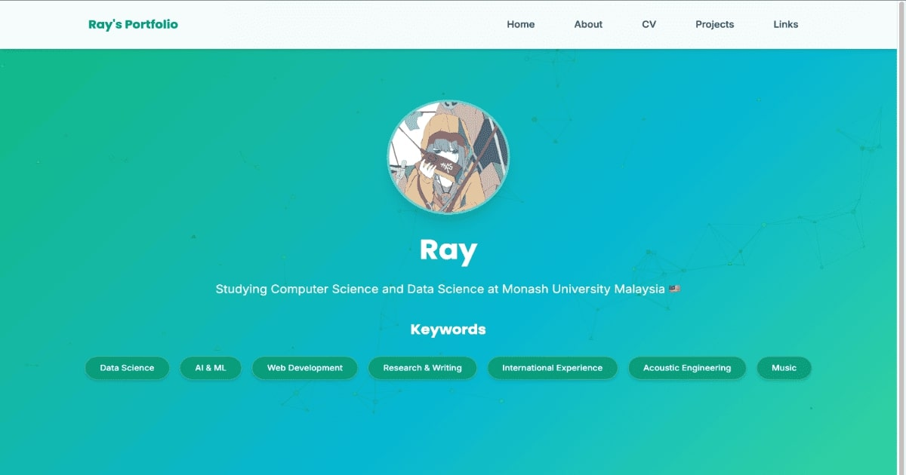

# Portfolio Website Template

[](https://opensource.org/licenses/MIT)
[](https://nodejs.org/)

**[🇯🇵 日本語版 / Japanese](README.ja.md)**

---

A clean, responsive, and **bilingual** portfolio template built with vanilla HTML, CSS, and JavaScript. Free to fork, customize, and deploy.

**[🌟 Live Demo](https://rayramy04.github.io/portfolio/)** | **[📝 Changelog](CHANGELOG.md)**



## Features

- **Bilingual** - Full English/Japanese support, switchable from the nav or a `?lang=` URL parameter
- **Data-driven** - Edit content via JSON-like JavaScript files
- **Responsive** - Mobile-first design, works on all devices
- **Zero Dependencies** - Pure HTML/CSS/JS, no build step required
- **SEO Optimized** - Meta tags, sitemap, structured data
- **Customizable** - Easy color themes and content updates
- **Fork-friendly** - Merge strategy protects your customizations

## Quick Start

```bash
# 1. Fork this repository on GitHub

# 2. Clone your fork
git clone https://github.com/YOUR-USERNAME/portfolio.git
cd portfolio

# 3. Edit your content
vim data/seo-config.js    # Your name, URLs, meta tags
vim data/common.js        # Social links, navigation
vim data/about.js         # Your story and values
vim data/summary.js       # Quick overview/summary
vim data/cv.js            # Experience and skills
vim data/projects.js      # Your projects

# 4. Regenerate HTML pages
node generate-pages.js

# 5. Test locally
python -m http.server 8000
# Open http://localhost:8000

# 6. Deploy to GitHub Pages
git add . && git commit -m "Update portfolio content" && git push
```

## Customization

### Essential Files to Edit

| File | Purpose |
|------|---------|
| `data/seo-config.js` | Name, URLs, meta descriptions |
| `data/common.js` | Language settings, social links |
| `data/about.js` | Personal story and values |
| `data/summary.js` | Quick overview/summary page content |
| `data/cv.js` | Work experience, skills, achievements |
| `data/projects.js` | Your projects |
| `css/palette.css` | Brand colors |
| `assets/**` | Replace with your images |
| `resume/**` | Add `resume-en.pdf` and `resume-ja.pdf` (optional) |

### Bilingual Content Format

All data files support bilingual objects:

```javascript
{
    title: {
        en: "Software Engineer",
        ja: "ソフトウェアエンジニア"
    },
    description: {  // optional, depending on the section
        en: "Built scalable web applications",
        ja: "スケーラブルなWebアプリケーションを構築"
    }
}
```

### Change Colors

Edit `css/palette.css`:

```css
:root {
  --color-primary: #059669;        /* Your brand color */
  --color-primary-light: #34d399;
  --color-primary-dark: #047857;
}
```

### Set Default Language

Edit `data/common.js`:

```javascript
lang: {
    current: 'en',  // 'en' or 'ja'
    available: ['en', 'ja']
}
```

This is what a first-time visitor sees. Returning visitors keep whichever language they last picked.

### Share a Link in a Specific Language

Add `?lang=en` or `?lang=ja` to any URL to decide the language a visitor lands on, regardless of the default:

```
https://your-site.com/?lang=ja
https://your-site.com/summary.html?lang=en
```

The language is saved to `localStorage`, so it sticks as the visitor moves to other pages. Handy for sending the same site to different audiences - an English link for one, a Japanese link for another - without asking them to find the switcher.

Values other than those in `available` are ignored. The nav switcher always overrides the parameter.

### Data Format Notes

- **`period` (education / experience)**: write `YYYY.MM - YYYY.MM` or `YYYY.MM - Present` (a hyphen with spaces on both sides). Experience is sorted automatically: ongoing roles first, then by end date (newest first), with the start date breaking ties. Education is sorted by start date. Awards, certifications and grants are sorted by `date`.
- **Project categories**: the filter buttons come from `window.projectCategories` in `data/projects.js`. Give each project at most 3 `categories` (ideally one or two), spelled exactly as in that list. Pick the category that best describes what the project *is*, not every technology it uses.
- **After editing data or templates**, run `node generate-pages.js`. It rebuilds the HTML pages and `sitemap.xml`, and it rewrites the static filter buttons in `projects.html` from `window.projectCategories`.

## Fork & Update Workflow

This template is designed to be **forked and kept in sync** with upstream updates.

### How It Works

`./sync-template.sh` merges the upstream template into your fork and then puts your content back exactly as it was:

- You get new template features and bug fixes
- **Your content and colors stay exactly as they are** (see the list below)
- Pages are regenerated from the merged template and your data

**Kept as yours** (listed with `merge=ours` in `.gitattributes`):
- `data/**` - Your content (name, projects, experience)
- `css/palette.css` - Your brand colors
- `assets/**`, `resume/**` - Your images and PDFs
- `robots.txt`, `sitemap.xml`, `index.html`, `about.html`, `summary.html`, `cv.html`, `projects.html`, `links.html` - Search-engine settings and generated pages (the script rebuilds them)

**Merged from upstream:** everything else, for example `generate-pages.js`, `template-base.html`, `content/*.html`, `js/**` and `css/style.css`. Upstream's changes to these files come in. If you also edited one of them, git merges both sides and the script stops on a conflict for you to resolve.

> **Why a script?** `merge=ours` on its own only decides *conflicts*, that is, files changed on both sides since the last common commit. A protected file that only upstream changed would be overwritten. The script merges with `--no-commit`, restores every `merge=ours` path from your side (and removes protected files that upstream added), regenerates the pages and commits. If a file that is not protected conflicts, it stops and lists it.

The script reads the `merge=ours` lines of your `.gitattributes`, so you can add your own (for example your own README or CI file).

### One-Time Setup

After forking, configure the merge strategy:

```bash
git config --local merge.ours.driver true

# Optional: Auto-regenerate HTML after a plain `git merge`
cp .github/hooks/post-merge .git/hooks/post-merge
chmod +x .git/hooks/post-merge
```

### Syncing Template Updates

```bash
./sync-template.sh
git push
```

The script adds the `template-upstream` remote, fetches, asks for confirmation, merges, restores your protected files, runs `node generate-pages.js` and commits.

Avoid a plain `git merge template-upstream/main` unless you check afterwards that none of the files marked `merge=ours` in `.gitattributes` changed (for example `git diff ORIG_HEAD HEAD --stat -- data assets resume css/palette.css robots.txt`).

**For detailed setup instructions**: See [TEMPLATE_SETUP.md](TEMPLATE_SETUP.md)

## Project Structure

```
portfolio/
├── data/              # ← Edit these for your content
│   ├── seo-config.js
│   ├── common.js
│   ├── about.js
│   ├── summary.js
│   ├── cv.js
│   └── projects.js
├── assets/            # ← Your images
├── css/
│   └── palette.css    # ← Your colors
├── resume/            # ← resume-en.pdf, resume-ja.pdf
├── generate-pages.js  # ← Run to regenerate HTML
└── *.html             # Generated pages
```

## Deployment

### GitHub Pages

1. Push to GitHub
2. Go to Settings → Pages
3. Set source to `main` branch → Save
4. Update `baseUrl` in `data/seo-config.js` with your GitHub Pages URL

Works on any static hosting (Netlify, Vercel, Cloudflare Pages, etc.).

## SEO Settings

Control search engine visibility with `robots.txt`:

**Public** (default):
```txt
User-agent: *
Allow: /
```

**Private** (direct link only):
```txt
User-agent: *
Disallow: /
```

## Contributing

Contributions welcome! Please:
1. Fork the repository
2. Create a feature branch (`git checkout -b feature/NewFeature`)
3. Test with both English and Japanese content
4. Submit a pull request

## License

MIT License - Free for personal and commercial use. See [LICENSE](LICENSE) for details.

## Credits

- [Font Awesome](https://fontawesome.com/) - Icons
- [Google Fonts](https://fonts.google.com/) - Typography
- [Particles.js](https://vincentgarreau.com/particles.js/) - Background animations

---

**Version**: 1.3 | **Requires**: Node.js 15.0+
